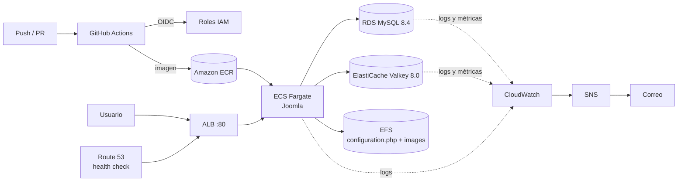

# iac-joomla-aws

Infraestructura como código (Terraform) de Joomla en AWS, con CI/CD en GitHub Actions y observabilidad en CloudWatch.

Actividad 6 · Introducción a Modelos de Informática en la Nube · ITM
Santiago Villada Arboleda · Oscar Alexis Pineda Henao · Santiago Pabón Acevedo

La aplicación es el repositorio `joomla-app` (fork de Joomla 5.4.10), que tiene su propio pipeline.

## Arquitectura



| Capa | Servicio | Detalle |
|---|---|---|
| Red | VPC `10.20.0.0/16` | 2 subredes públicas (ALB y tareas) y 2 privadas (RDS, Valkey, EFS); 5 grupos de seguridad encadenados |
| Contenedores | ECS Fargate | 0,5 vCPU / 1 GB, rolling update sin caída (100 % / 200 %) y circuit breaker con rollback |
| BD relacional | RDS for MySQL 8.4 | `db.t4g.micro`, cifrada, logs de error y de consultas lentas en CloudWatch |
| BD en memoria | ElastiCache for Valkey 8.0 | `cache.t4g.micro`; caché de Joomla (DB 0) y sesiones (DB 1); slow log en CloudWatch |
| Archivos | EFS | Solo `configuration.php` e `images/`; el código viaja en la imagen |
| Observabilidad | CloudWatch, SNS, Route 53, EventBridge | 14 alarmas, dashboard, consultas de Logs Insights, avisos de despliegue |

## Estructura

```
bootstrap/                 Se aplica una vez desde el computador (estado local)
infra/
  backend.tf               Estado remoto en S3 con bloqueo nativo (use_lockfile)
  env/prod.tfvars          Valores del ambiente (sin secretos)
  main.tf                  Llamado a los módulos
  modules/
    networking/            VPC, subredes, rutas y grupos de seguridad
    database/              RDS MySQL + grupo de parámetros + logs
    cache/                 ElastiCache Valkey + slow log
    storage/               EFS + punto de acceso (UID/GID 33)
    compute/               ALB, ECS (cluster, tarea, servicio), SSM, IAM
    monitoring/            SNS, Route 53, alarmas, EventBridge, Logs Insights, dashboard
  tests/                   terraform test con proveedores simulados
.github/workflows/         infra-plan, infra-apply, infra-destroy
```

## Bootstrap

Crea lo que los pipelines necesitan antes de poder correr:

- AWS: bucket S3 del estado (versionado, cifrado, sin acceso público, solo HTTPS), repositorio ECR con escaneo de imágenes, proveedor OIDC de GitHub, tres roles IAM y un presupuesto mensual.
- GitHub: los dos repositorios públicos, el environment `production` de cada uno (en infraestructura con aprobación obligatoria y solo desde `main`) y las variables y secretos de Actions.

```bash
cd bootstrap
cp terraform.tfvars.example terraform.tfvars   # usuario de GitHub y correo
export GITHUB_TOKEN=$(gh auth token)
terraform init && terraform apply
```

## Pipelines

| Workflow | Evento | Pasos |
|---|---|---|
| `infra-plan` | PR a `main` | `fmt -check`, `init`, `validate`, `tflint`, `terraform test`, `plan`; el plan se publica como comentario del PR |
| `infra-apply` | push a `main` (cambios en `infra/`) | `plan` con rol de solo lectura → **aprobación** en el environment `production` → `apply` del mismo plan → verificación de `/health.php` |
| `infra-destroy` | manual, escribiendo `destroy` | **aprobación** → `plan -destroy` → `apply` |

GitHub Actions entra a AWS por OIDC, sin llaves guardadas. Cada rol solo acepta tokens de su repositorio y contexto:

| Rol | Quién lo usa | Permisos |
|---|---|---|
| `joomla-ecs-github-iac-plan` | PR y rama `main` de este repo | `ReadOnlyAccess` |
| `joomla-ecs-github-iac-apply` | environment `production` de este repo | `AdministratorAccess` |
| `joomla-ecs-github-app-deploy` | environment `production` de `joomla-app` | Push al repositorio ECR, `UpdateService` del servicio y lectura de `/joomla-ecs/app/*` |

Las contraseñas de MySQL y del superusuario de Joomla las genera Terraform (`random_password`), quedan en SSM Parameter Store como `SecureString` y llegan al contenedor como `secrets` de ECS.

## Observabilidad

**Alarmas** (todas notifican por SNS al entrar en ALARM y al volver a OK):

| Grupo | Alarma | Condición |
|---|---|---|
| Backend | Sitio caído | Health check de Route 53 falla 2 minutos |
| Backend | Errores 5xx de Joomla | Más de 10 en un minuto |
| Backend | Errores 5xx del ALB | Más de 10 en un minuto (sin tareas sanas o sin respuesta) |
| Backend | Latencia p95 | Más de 2 s durante 5 minutos |
| Backend | Sin tareas sanas | 0 tareas sanas durante 3 minutos |
| Backend | CPU / memoria de ECS | Más de 80 % / 85 % durante 5 minutos |
| Backend | Errores fatales de PHP | Más de 5 en un minuto (filtro de métricas sobre los logs) |
| BD | CPU de RDS | Más de 80 % durante 10 minutos |
| BD | Disco de RDS | Menos de 2 GB libres |
| BD | Conexiones de RDS | Más de 60 durante 5 minutos |
| BD | Memoria de RDS | Menos de 64 MB libres durante 10 minutos |
| BD | CPU / memoria de Valkey | Más de 80 % / 85 % durante 10 minutos |

Además, una regla de EventBridge avisa por el mismo tema SNS cada despliegue de ECS completado o fallido.

**Dashboard** `joomla-ecs`: disponibilidad y tráfico, contenedores, últimos errores (Logs Insights), RDS, Valkey y estado de las alarmas.

**Consultas guardadas** de Logs Insights: errores PHP, peticiones 5xx por ruta, páginas más visitadas, arranques del contenedor, errores y consultas lentas de MySQL, comandos lentos de Valkey.

**Prueba de alarmas**: con `fault_injection_enabled = true`, `/health.php?simulate=error` responde 500 y `/health.php?simulate=fatal` provoca un error fatal de PHP.

```bash
URL=$(aws ssm get-parameter --name /joomla-ecs/app/url --query Parameter.Value --output text)
for i in $(seq 1 30); do curl -s -o /dev/null "$URL/health.php?simulate=error"; done
for i in $(seq 1 10); do curl -s -o /dev/null "$URL/health.php?simulate=fatal"; done
```

## Costo aproximado

Con la infraestructura encendida, unos US$ 0,10 por hora (Fargate, ALB, RDS, ElastiCache e IPv4 públicas). Se destruye con `infra-destroy` al terminar; `bootstrap` casi no genera costo.
